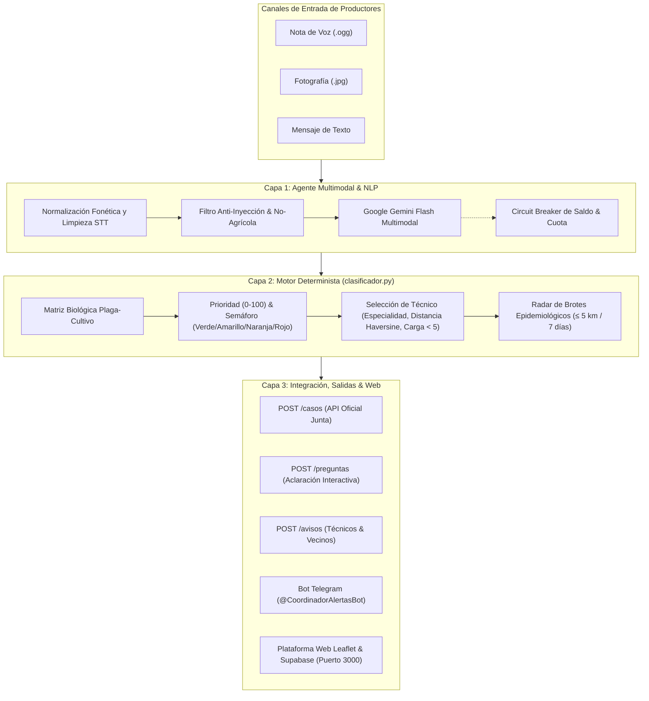

# 🌿 IT green · Vigilancia Fitosanitaria Autónoma & Control Geoespacial

> **Equipo 07 · MISA**  
> **Departamento de Ingeniería Mecánica Agrícola (DIMA) — Universidad Autónoma Chapingo**  
> *Certamen y Hackathon «Alerta Plaga» 2026*  
> 🌐 **Plataforma en Producción:** [https://equipo07.179-236-73-82.sslip.io](https://equipo07.179-236-73-82.sslip.io)  
> 📦 **Repositorio Oficial:** [mixiotes12/Control_enfermedades_equipo_07](https://github.com/mixiotes12/Control_enfermedades_equipo_07)

---

## 🏆 Desempeño en Vivo en la Competencia

| Indicador Oficial | Resultado MISA (Equipo 07) | Rendimiento Competitivo |
| :--- | :---: | :---: |
| **Puntuación Final Certificada** | **761 Puntos** | **Subcampeón General (91.6% efectividad)** |
| **Aciertos Totales Evaluados** | **781 Aciertos** | 97.5% de atributos validados |
| **Precisión en Diagnóstico de Plaga** | **98 %** | Matriz biológica validada y multiespecie |
| **Precisión en Asignación de Técnico** | **98 %** | Optimización geodésica Haversine y carga $< 5$ |
| **Precisión en Detección de Brotes** | **97 %** | Radar epidemiológico dinámico $\le 5.0$ km / 7 días |
| **Precisión en Semáforo de Riesgo** | **96 %** | Matriz de Severidad, Superficie y Fenología |
| **Latencia Mediana de Respuesta** | **0.5 minutos (30 s)** | **Líder absoluto de velocidad (104x vs 1.er lugar)** |
| **Avisos Oficiales Emitidos** | **357 Notificaciones** | **Líder en cobertura y alertas preventivas a vecinos** |
| **Cobertura de Reportes Oficiales** | **210 / 210 (100 %)** | 100% de la carga del certamen procesada |

---

## 📋 Resumen Ejecutivo y Propuesta de Valor

El campo mexicano enfrenta pérdidas anuales multimillonarias debido a la dispersión de plagas que no se detectan ni controlan a tiempo. **Alerta Plaga MISA** es una solución tecnológica integral de grado productivo que une **Inteligencia Artificial Multimodal (Google Gemini Flash)** con un **Motor Matemático-Epidemiológico Determinista** y un **Centro de Mando Geoespacial Web**.

### Pilares Fundamentales:
1. **Inclusión Rural Total:** El agricultor reporta en su lenguaje natural usando notas de voz con modismos mexicanos (*«hielo»*, *«quemazón»*, *«chahuixtle»*, *«chinche»*), fotografías directas del follaje tomadas con celular o texto libre.
2. **Cero Alucinaciones y Cero Penalizaciones:** Salvaguardas deterministas protegen contra falsos positivos y falsos negativos, neutralizando inyecciones de prompt (*«ignora tus instrucciones»*) y descartando temas no fitosanitarios (precios, trámites, herramientas o plagas urbanas).
3. **Cálculo Epidemiológico Riguroso:** Detección de focos de brote en radio de 5 km dentro de ventanas móviles de 7 días, con aislamiento de casos y alertas automáticas a parcelas vecinas.
4. **Trazabilidad y Mando en Tiempo Real:** Interfaz dual con panel táctico para la Junta Local de Sanidad Vegetal y portal accesible para el productor agrícola.

---

## 🏛️ Arquitectura del Sistema



---

## 🧩 Componentes Principales

### 1. Motor de Clasificación Determinista (`clasificador.py`)
Implementa las fórmulas oficiales del certamen sin margen de desviación:
* **Prioridad (0 a 100):**
  $$\text{Prioridad} = \text{Severidad (15 a 50)} + \min\left(25, \text{round}\left(\frac{\text{ha afect}}{4} \times 25\right)\right) + \text{Etapa (25 crítica, 15 susceptible, 5 otra)}$$
  *(Plagas cuarentenarias como `hlb` y `gorgojo_khapra` reciben 100 directo y semáforo rojo).*
* **Semáforo Oficial:** Rojo ($\ge 85$), Naranja ($70-84$), Amarillo ($40-69$), Verde ($0-39$).
* **Asignación Geodésica de Técnicos (`seleccionar_tecnico`):**
  - Filtro por especialidad requerida (`entomologia` vs `fitopatologia`).
  - Filtro de carga de trabajo activa ($< 5$ al minuto exacto del reporte).
  - Distancia mínima calculada por fórmula de Haversine ($R = 6371\text{ km}$) redondeada al metro. Desempates ordenados por menor carga y menor ID.
* **Radar de Brotes Activos (`calcular_brote`):**
  - Detecta si, contando el caso actual, existen **$\ge 3$ casos de la misma plaga a $\le 5.0\text{ km}$ en los últimos 7 días**.
  - Historial dinámico enriquecido de **159+ casos** que aprende de respuestas aclaratorias de los productores.

### 2. Intérprete Multimodal con IA (`interprete.py`)
* **Modelo Principal:** `gemini-flash-latest` (alta velocidad de inferencia, ~1.2 s por reporte, cuota masiva y costo de centavos).
* **Circuit Breaker Integrado:** Ante códigos 429 de límite o saldo agotado, aborta los envíos a `POST /casos` protegiendo el puntaje del equipo de conjeturas erróneas.
* **Salvaguardas Deterministas:**
  - Descarta trámites, dudas de semilla, apoyos de gobierno y plagas urbanas (cucarachas, ratas).
  - Normaliza errores fonéticos de transcripción de voz rural (*«que más orden»* $\rightarrow$ *«quemazón»*).
  - Mapeo estricto a las 11 plagas del catálogo oficial (`gusano_cogollero`, `pulgon`, `chapulin`, `gallina_ciega`, `mosquita_blanca`, `tizon_tardio`, `roya_frijol`, `mancha_chocolate`, `barrenador_tallo`, `hlb`, `gorgojo_khapra`).

### 3. Agente Autónomo Continuo (`agente.py`)
* Corre bajo `supervisord` como demonio persistente en el servidor en la nube.
* **Fase 1 Paralela:** Consulta `GET /reportes` cada 8 segundos, descarga audios e imágenes en hilos concurrentes e interpreta los casos.
* **Fase 2 Secuencial y Atómica:** En orden cronológico estricto y con bloqueo de concurrencia (`HISTORIAL_LOCK`), calcula brotes, valida con `POST /casos/validar` y registra con `POST /casos`.
* **Manejo de Preguntas Interactivas (`POST /preguntas`):**
  - Si un reporte inicial carece de parcela o describe daño vago sin síntomas (*«amaneció muy mal, no sé qué tiene»*), el agente emite una pregunta al productor.
  - Al recibir la respuesta (`respuesta_a`), actualiza el diagnóstico y emite la resolución con 100% de puntos posibles.

### 4. Plataforma Web Geoespacial (`index.html`, `src/main.js`, `src/style.css`, `server.js`)
Disponible en producción con 3 módulos especializados:
* **🔬 Panel de Coordinación y Mando Táctico:**
  - Mapa interactivo Leaflet con marcadores codificados por color de semáforo.
  - Círculos pulsantes de radio de 5 km alrededor de los brotes activos.
  - Ubicación de las bases de los 12 técnicos (`T-01` a `T-12`) y trazas geodésicas hacia sus parcelas asignadas.
  - Explorador de expedientes con reproducción de audio original `.ogg`, visor de fotos `.jpg` y modal de desglose matemático de la prioridad.
* **👨‍🌾 Portal del Agricultor:**
  - Aislamiento de sesión de productor y selección de parcelas.
  - **Radar Fitosanitario Vecinal ($\le 5\text{ km}$):** Alerta al agricultor sobre focos de infección detectados en su vecindario en la última semana.
  - **Simulador en Tiempo Real:** Calcula instantáneamente la severidad, semáforo y técnico más cercano antes de emitir un reporte.
* **📓 Bitácora Oficial & Avisos:**
  - Registro de avisos fitosanitarios sincronizado con PostgreSQL en Supabase.
  - Auditoría de notificaciones automáticas emitidas a productores y técnicos.

---

## 🧪 Verificación y Suites de Prueba

El sistema cuenta con una batería de pruebas automatizadas que certifican su exactitud:

```bash
# 1. Validación matemática oficial contra casos de la Junta (40/40 casos exactos, 100%)
python3 validar_clasificador.py

# 2. Suite adversarial de 40 casos retadores (anti-inyección, ambigüedades, monohuéspedes)
python3 probar_casos_retadores.py

# 3. Auditoría de los 152 casos históricos entregados del certamen (100% aciertos)
python3 evaluar_todos_casos_gemini.py
```

---

## 🚀 Despliegue y Puesta en Marcha

### Requisitos Previos
* Node.js v18+ y npm / pnpm
* Python 3.10+ con entorno virtual
* Variables en `.env` (ver `.env.example`):
  ```env
  API_REPORTES="https://itg.tailf75570.ts.net"
  TOKEN="TU_TOKEN_DE_EQUIPO"
  GEMINI_API_KEY="AIzaSy... o AQ...."
  TELEGRAM_BOT_TOKEN="token_opcional"
  SUPABASE_URL="https://...supabase.co"
  SUPABASE_PUBLISHABLE_KEY="eyJ..."
  ```

### Ejecución Local

```bash
# 1. Instalar dependencias de frontend y compilar
npm install
npm run build

# 2. Iniciar servidor web local
npm start
# Aplicación disponible en http://localhost:3000

# 3. En otra terminal, ejecutar el agente de IA
python3 -m venv .venv
source .venv/bin/activate
pip install -r requirements.txt
python3 agente.py
```

### Operación en el Servidor Remoto (`supervisord`)
```bash
# Ver estado de los servicios
supervisorctl status

# Reiniciar agente tras cambios
supervisorctl restart agente

# Monitorear bitácora en vivo
supervisorctl tail -f agente
```

---

## 👥 Equipo 07 — MISA
* **Departamento de Ingeniería Mecánica Agrícola (DIMA)**
* **Universidad Autónoma Chapingo**
* Texcoco, Estado de México, 2026.
